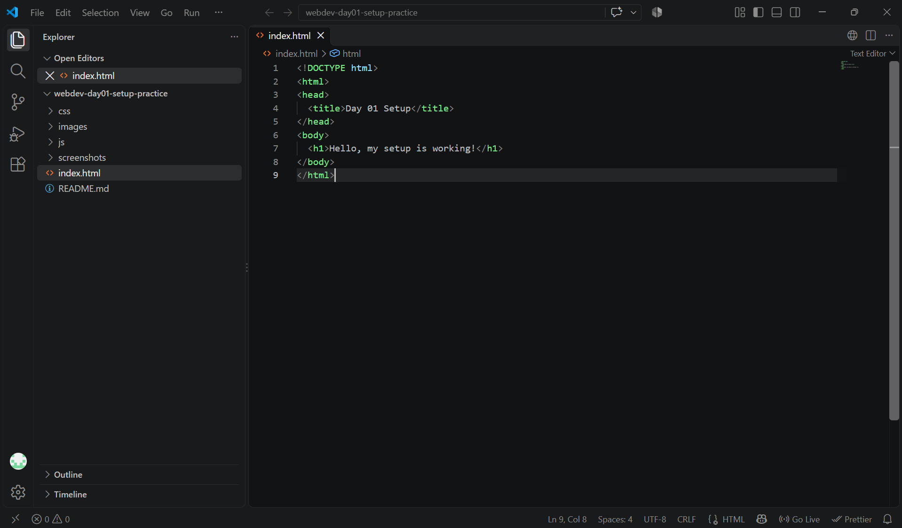
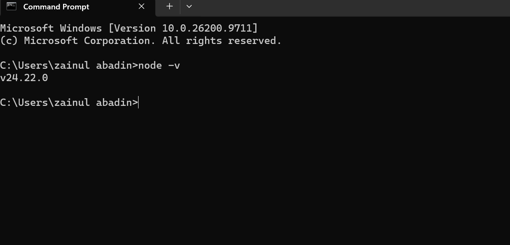
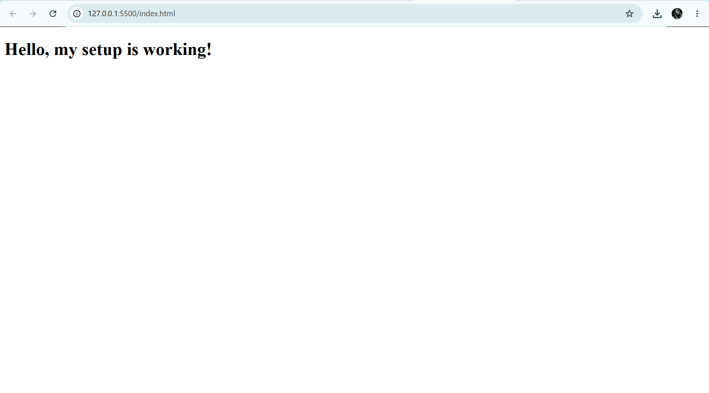
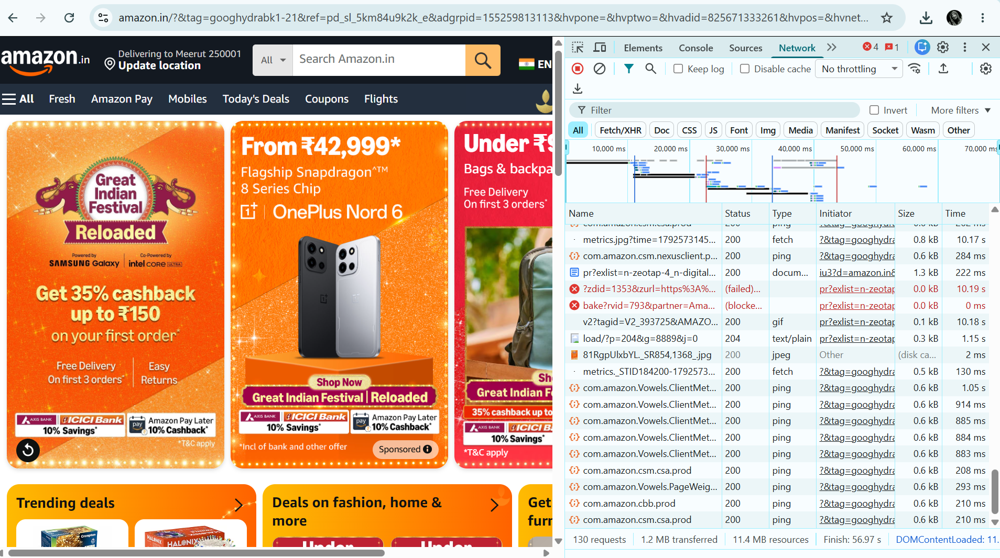

# Web Development Day 01

Practice project for setting up a web development workspace.

## Contents

- `index.html` - the project page
- `css/style.css` - page styles
- `js/script.js` - JavaScript file
- `screenshots/` - setup evidence screenshots
- `network-inspection.md` - Chrome DevTools notes
- `terminal-practice.md` - terminal practice notes

## Setup screenshots

### VS Code with the project open

### Node.js version

### Page running with Live Server

### Chrome DevTools Network panel

## What happens when I enter a URL

When we open a website in a browser, it first uses DNS to find the website’s server. Then, the browser sends a request to that server. The server responds by sending files like HTML, CSS, JavaScript, and images. The browser reads these files, puts everything together, and displays the website on our screen.